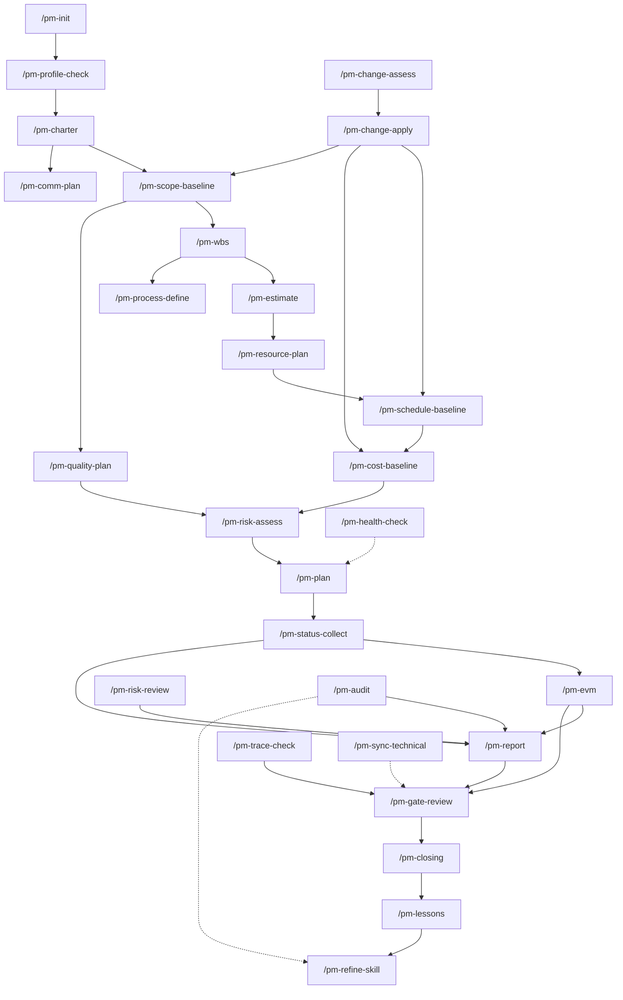

# Command Flow

How the 28 commands relate: what each consumes and produces, what must run before what, and
the control loop the pack is built around.

---

## 1. Command catalogue

### Setup — run once

| Command | Reads | Writes | Agent |
|---|---|---|---|
| `/pm-init` | the repository, a technical profile if present | `pm.profile.yaml`, `pm/` scaffold, registers, `CLAUDE.md` | — |
| `/pm-profile-check` | profile, technical profile | nothing (report only) | — |

### Plan — produce the baselines

In order. Each consumes the one above it.

| Command | Reads | Writes | Agent |
|---|---|---|---|
| `/pm-charter` | business case, contract, governance | project charter; seeds RSK/ASM/DEP/DEC | `pm-planner` |
| `/pm-scope-baseline` | charter, requirements source | scope statement, RTM | `pm-planner` |
| `/pm-wbs` | scope statement, deliverables | **WBS + dictionary as one Excel workbook** at `paths.wbs` | `pm-planner` |
| `/pm-estimate` | WBS dictionary, productivity rates | estimate record | `pm-estimator` |
| `/pm-resource-plan` | WBS, schedule draft | staffing plan, RACI; key-person risks | `pm-planner` |
| `/pm-schedule-baseline` | WBS, estimate, resource plan, calendar | schedule baseline + working file | `pm-planner` |
| `/pm-cost-baseline` | estimate, schedule, rates | cost baseline, reserves, billing plan | `pm-estimator` |
| `/pm-quality-plan` | scope, requirements, technical pack | quality plan, master test plan | `pm-quality-manager` |
| `/pm-process-define` | organisational standard, technical pack | process definition, tailoring record, CAPA log | `pm-quality-manager` |
| `/pm-comm-plan` | governance, stakeholders | stakeholder register, communications plan | `pm-planner` |
| `/pm-risk-assess` | all of the above, assumption log | risk register with responses and triggers | `pm-risk-manager` |
| `/pm-plan` | every subsidiary plan | project management plan | `pm-planner` |

### Execute and control — measure, report, decide

| Command | Reads | Writes | Agent |
|---|---|---|---|
| `/pm-status-collect` | trackers, timesheets, test results, CI, registers | the period's status data file | `pm-controller` |
| `/pm-evm` | status data, cost and schedule baselines | EVM figures and variance analysis | `pm-controller` |
| `/pm-report <cadence>` | status data, EVM, registers | daily / weekly / monthly / quarterly / quality report | `pm-controller` |
| `/pm-risk-review` | registers, triggers, contingency log | updated registers, escalations | `pm-risk-manager` |
| `/pm-audit` | artifacts on disk vs the process | audit record, non-conformances, CAPAs | `pm-quality-manager` |
| `/pm-trace-check` | baselines, RTM, registers | consistency and orphan report | — |
| `/pm-health-check` | everything on disk | RAG per area, the three likely failure causes | — |
| `/pm-sync-technical` | both profiles and both sets of artifacts | drift report and proposed corrections | — |

### Change — the only legitimate way a baseline moves

| Command | Reads | Writes | Agent |
|---|---|---|---|
| `/pm-change-assess` | the request, baselines, technical context map | CR register entry, impact matrix, options — **no changes** | `pm-change-analyst` |
| `/pm-change-apply` | an approved CR | updated baselines, `DEC-*`, handoff to the technical pack, closed CR | `pm-change-analyst` |

### Decide and record

| Command | Purpose |
|---|---|
| `/pm-gate-review` | proceed / conditions / hold / stop, with evidence, recorded |
| `/pm-closing` | acceptance, handover, contract closure, final report, archive |
| `/pm-lessons` | capture lessons with destinations and owners |
| `/pm-refine-skill` | feed a lesson or audit finding back into the pack |

---

## 2. Dependency graph

An arrow means "must have produced its artifact first".



**`/pm-gate-review` is where a phase actually ends.** It consumes `/pm-trace-check`,
`/pm-evm` and the quality report, records the decision, and baselines what it covers.

The `/pm-change-*` pair hangs off the graph rather than sitting in it: a change can arrive at
any time and re-opens the baselines it touches. Its two non-negotiable arrows are internal —
assess before decide, decide before apply.

---

### A note on the WBS step

`/pm-wbs` produces an Excel workbook, not a Markdown document. `wbs` is in
`{{profile.documents.binary_final}}`, so the workbook existing at `{{profile.paths.wbs}}`
**is** the step's completion criterion (MD-09) — a complete Markdown WBS is a working file
and the step is not done.

Drafting in text first is encouraged and is what `{{profile.documents.working_dir}}` is for.
Two things keep that safe: every scratch file is stamped on line one as a draft or as a
generated export (MD-10), and the workbook is never regenerated from a working file older
than itself — which is what would otherwise erase a direct edit somebody made to the
workbook between sessions.

Everything downstream of this step — `/pm-estimate`, `/pm-cost-baseline`,
`/pm-schedule-baseline`, `/pm-evm` — indexes into the WBS by code. That is why the format is
fixed here rather than left to preference.

## 3. The control loop

Planning happens once per baseline. This runs every period, forever:

```
       ┌───────────────────────────────────────────────────────┐
       │                                                       │
  /pm-status-collect ──► /pm-evm ──► /pm-report ──► decision   │
       ▲                     │            │                    │
       │                     │            └──► /pm-gate-review  │
       │                     │                                  │
       │              /pm-trace-check                           │
       │                                                        │
       └──── /pm-change-apply ◄── /pm-change-assess ◄── a change ┘
                    │
                    └──► baselines move, and the loop measures against the new ones
```

Two properties the loop depends on:

1. **Collection precedes reporting, always.** A report assembled without
   `/pm-status-collect` is assembled from memory, and one unverified number makes the whole
   reporting history untrustworthy (RI-02).
2. **Baselines move only through `/pm-change-apply`.** Any other route — a helpful edit, an
   absorbed small change, a quiet re-plan — removes the ability to explain the variance later.

---

## 4. Cadence: what runs when

| When | Commands |
|---|---|
| Daily | `/pm-report daily` |
| Weekly | `/pm-status-collect` → `/pm-report weekly`; `/pm-risk-review weekly` |
| Monthly | `/pm-status-collect` → `/pm-evm` → `/pm-report monthly` + `/pm-report quality`; `/pm-risk-review monthly`; `/pm-audit`; `/pm-sync-technical` |
| Quarterly | `/pm-report quarterly` |
| Per gate / milestone | `/pm-trace-check` → `/pm-evm` → `/pm-gate-review` → `/pm-lessons` |
| On a change | `/pm-change-assess` → (approval) → `/pm-change-apply` |
| On an incident or escalation | `/pm-risk-review`, then `/pm-lessons` if it was unforeseen |
| On taking over a project | `/pm-profile-check`, `/pm-trace-check`, `/pm-health-check` |
| At closing | `/pm-closing` → `/pm-lessons` → `/pm-refine-skill` |

---

## 5. The refinement loop

The pack is meant to get better between projects, not only between releases:

```
/pm-audit or a gate finding or an escaped defect
        │
        ▼
/pm-lessons   ← quantified impact, root cause, destination, owner
        │
        ▼
/pm-refine-skill   ← hook > profile field > rule > skill section > command step > checklist row
        │
        ▼
the next project starts with the check that was missing
```

The question that drives it is always the same: **which check would have caught this, and why
did it not run?** A lesson that cannot answer it is not yet a lesson — it is an investigation.

---

## 6. What each command refuses to do

Worth knowing, because these refusals are the pack working rather than failing:

| Command | Refuses to |
|---|---|
| `/pm-report` | write a report when the period's status was never collected |
| `/pm-evm` | compute indices when progress is self-assessed or actuals come from the plan |
| `/pm-change-apply` | apply a CR with no written approval from the named authority |
| `/pm-gate-review` | record a gate as passed when a criterion could not be evaluated |
| `/pm-estimate` | issue a number without method, basis and range — or one reconciled to a target |
| `/pm-schedule-baseline` | baseline a schedule that fails its feasibility checks |
| any planning command | substitute a plausible value for an unresolved profile placeholder |
