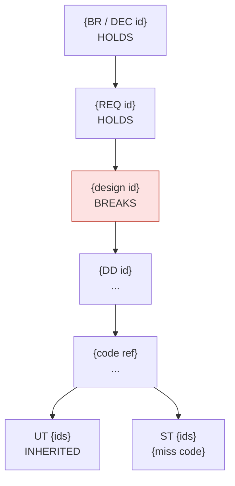

# Bug Traceability — one defect, the whole chain

> Prerequisite: `sdlc-project` resolved. Read-only on everything except the dossier and its
> register row under `{{profile.paths.bug_traces}}`.

`sdlc-defect-management` asks for an injection phase and calls it a judgement.
`sdlc-maintenance` asks, in its RCA, *why was it not caught?* This skill turns both into
evidence, by answering three questions for one defect:

1. **Where did the defect enter?** The first link of the chain that is wrong against the
   baseline — not the file the fix will touch.
2. **Which change put it there, and what has happened to it since?** The introducing commit,
   every commit on that code since, the merge and the release that shipped it.
3. **Why was it found here and not earlier?** The check that the V-model assigns to it, and —
   with evidence — why that check and every one after it missed.

The first answer fixes a defect. The other two are what make phase containment (QM-04) and
escaped defects (QM-06) measurements instead of opinions.

| Situation | Use |
|---|---|
| A failed run needs classifying | `sdlc-defect-management` first; this skill per defect worth tracing |
| A UAT report needs a classification | `/sdlc-uat-triage` first; this skill once it is a defect |
| An incident needs a fix | `sdlc-maintenance` first; this skill answers RCA question 2 |
| Any defect whose origin, history or late detection must be proven | this skill |

---

## Standing constraints

**C1 — read-only.** No edit to code, documents, test cases or registers other than the
bug-trace register. The dossier and its register row are the only writes. A fix goes through
`/sdlc-maintain-fix` or the module's normal route, behind its own approval.

**C2 — every link is anchored or declared unverified.** Each chain row cites a `path:line`,
a document id and section, a commit hash, or a test id and round. A row without evidence is
`UNVERIFIED`, with what would verify it — never inferred from the rows around it (RS-01).

**C3 — the oracle is the baselined specification.** Expected behaviour comes from the
baselined documents (`{{profile.constraints.baselined}}`), their decisions and elicitation
records — never from the code (`rules/common/testing.md`). Two revisions matter: the one in
force when the code was written, and the one in force now; a difference between them is a CR
or an unrecorded edit, and the trace says which (BL-02). When no baselined document decides
the behaviour, the trace stops there as an open question (RS-04, RS-05).

**C4 — injection is decided by the chain, not by where the fix lands** (TR-07, QM-04). Walk
top-down; the injection point is the first broken link. "Found in UAT, fixed in code,
therefore injected in P4" is the attribution that makes containment report a flat 100%
upstream, and the error this skill exists to prevent.

**C5 — history is read, never moved.** Allowed: `log`, `blame`, `show`, `diff`, `rev-list`,
`rev-parse`, `merge-base`, `describe`, `name-rev`, `branch --contains`, `tag --contains`,
`cat-file`. Never, in the user's working tree: `checkout`, `switch`, `reset`, `restore`,
`stash`, `rebase`, `commit`, `push`, `fetch`, `bisect`. A bisect runs only on explicit
approval, inside a separate `git worktree` that is removed afterwards. Moving history
destroys the evidence being read, and the user's uncommitted work with it.

**C6 — name the commit, not the culprit.** Author and date are recorded because they are
evidence and because the author is who you ask. The attribution is allowed to embarrass a
phase (QM-04); it never names a person as the cause — no per-author counts, no ranking. A
trace that reads as blame gets suppressed the second time; a process trace gets acted on.

**C7 — the id comes from the tracking system.** `{{profile.ids.defect_id_format}}` or
`{{profile.ids.incident_id_format}}`, never invented (`sdlc-maintenance` C4). The trace can
run without it; the dossier cannot be filed without it — ask.

**C8 — report what was established, and only that** (QM-01). A shallow clone, squashed
history, documents kept outside version control, results never recorded: the section says so
and names what would close the gap. A plausible reconstruction presented as history is worse
than a stated gap — and a severity, class or phase adjusted to fit a gate is forbidden
outright (QM-08).

**C9 — language and location.** The dossier goes under `{{profile.paths.bug_traces}}` in the
language `{{profile.language.by_path}}` binds to that path (DS-09). IDs, hashes, paths and
code are never translated.

The `{{profile.bug_trace.*}}` keys are optional. An absent or empty key means *detect*, not
*stop*.

---

## 1. Establish the starting point

**Restate the defect**: id, module, symptom (action, input, observed, expected), severity and
priority **as recorded** — the trace does not reassess them — and the detection record:
phase, level, test id or reporter, environment from `{{profile.system.environments}}`,
**build or commit**, date. Without the detection build, "was the defect in what was tested?"
cannot be answered; ask for it before §4.

**Read what already exists** before re-deriving it: the defect record, the triage report, the
UAT triage or incident report under `{{profile.paths.uat}}` / `{{profile.paths.maintenance}}`,
the knowledge-base entry in `{{profile.maintenance.knowledge_base}}`, CR reports touching the
module under `{{profile.paths.change_requests}}`, the module's rows in
`{{profile.paths.traceability}}`. An existing conclusion — an injection phase already
recorded — is verified, not repeated; where the evidence disagrees, the disagreement goes
into the dossier.

**Fix the trace reference.** Every later statement is relative to it:

```bash
git -C <path> rev-parse --show-toplevel   # per path — design, code and tests may be separate repos
git rev-parse HEAD && git branch --show-current
git rev-parse --is-shallow-repository
```

A shallow clone cannot show introduction. Say so (C8) rather than report the oldest commit
it happens to hold as the origin.

---

## 2. Walk the chain — find the first broken link

| Layer | Artifact | Where | Phase |
|---|---|---|---|
| NEED | `BR-*`, `DEC-*`, `ASM-*`, elicitation records | `{{profile.paths.inception}}`, `{{profile.paths.decision_log}}`, `{{profile.paths.assumption_log}}` | P0 |
| REQ | `REQ-*`, `NFR-*`, acceptance criteria | `{{profile.paths.requirements}}` | P1 |
| BD | SC / FC / API / DT / NFR design | `{{profile.paths.design_root}}` | P2 |
| DD | detail design | `{{profile.paths.detail_design}}` | P3 |
| CODE | source symbol | `{{profile.system.root}}` | P4 |
| TEST | UT / IT / ST / UAT cases | `{{profile.paths.test_design}}`, `{{profile.testing.paths.testcase_root}}` | P5–P8 |

A `CR-*` in the ancestor position replaces NEED for exactly the behaviour its text
authorises, and nothing more (TR-02, `sdlc-change-request` C2).

Resolve the ids from the register, then confirm each against the file on disk — the register
alone is not evidence. Use the locator map in `sdlc-maintenance`; a repository-wide search as
the first move finds the symptom, not the cause.

For each layer record: the artifact, its anchor, its revision **and whether that revision was
baselined** at the time the code was written, a short quote of what it says about the
disputed behaviour, and a verdict **against the layer above**:

| Verdict | Meaning |
|---|---|
| `HOLDS` | states the layer above correctly |
| `BREAKS` | contradicts the layer above |
| `SILENT` | exists, says nothing about this behaviour |
| `ABSENT` | the artifact does not exist — no DD, no case |
| `UNVERIFIED` | exists, cannot be checked — say why |

### The injection rule

**The injection point is the first `BREAKS` from the top.** The edge cases below are most of
the real ones:

| Situation | Injection |
|---|---|
| No baselined document decides the behaviour | none — open question; ends in a `DEC-*` (RS-04, RS-05) |
| The requirement rests on an `ASM-*` that proved false | **P1** — cite the assumption; state whether it was confirmed by its confirm-by date (RS-02) |
| The requirement is ambiguous and two downstream layers read it two ways | **P1** — the ambiguity is the break; an untestable requirement was not finished (RS-07, TR-03) |
| A layer is `SILENT` where its own rules require it to speak (rounding under FD-R, nullability under API-C, precision under DT) and the code below is wrong | **that layer** — an omission is a break when the layer's rules demand the content; cite the rule |
| A layer is `SILENT` where nothing requires it, and the code is wrong | P4 |
| A layer `BREAKS`, but the code below happens to be right | that layer — a latent defect, still recorded |
| The code matched its design when written; a later change broke it | the **later change** — its phase and vehicle (§3.5) |
| Every layer `HOLDS`; a stakeholder wants something else | none — a change request, not a defect |
| The product layers `HOLD`; a test case `BREAKS` | the test's own phase — a case defect (`sdlc-defect-management` §2) |
| Data, environment, or a system this project does not own | none — `INC-DATA`, `INC-ENV`, `INC-EXTERNAL` |

The class stays the one `sdlc-defect-management`, `/sdlc-uat-triage` or `sdlc-maintenance`
assigned. The trace supplies the injection phase — one of `{{profile.quality.injection_phases}}`
— with the evidence behind it.

---

## 3. Code archaeology — the commit trail

For every defective location: the commit that introduced it, the full history of that code,
what carried it to the mainline and into which releases, and whether the baseline and the
design moved before or after the code. `git blame` is the start of this, never the answer — a
reformat, rename, move or merge rewrites it.

### 3.1 Locate

The `file:line` range from the CODE row of §2. For an **omission** — a missing condition,
branch or message — the location is the function where the code should be.

If the defect is already fixed, trace the parent of the fix, not `HEAD`: the defective lines
no longer exist there. Every command below takes `<fix-sha>^` in place of the working tree.

### 3.2 Candidate from blame

```bash
git blame -w -C -C -M --date=short -L <start>,<end> [<fix-sha>^] -- <file>
# add --ignore-revs-file .git-blame-ignore-revs when the repository has one
```

Blame reports the last commit to touch each line. That is a candidate, nothing more.

### 3.3 Confirm by walking the range

```bash
git log -L <start>,<end>:<file> --date=short --format='%h %ad %an %s'
git log -L :<function>:<file> ...     # when the range has moved since
git show <sha> -- <file>              # read the candidate's diff in full
```

The introducing commit is the **oldest commit in which the defective logic has its defective
form**. Its diff shows which of two things happened: the code was written wrong, or correct
code was changed into wrong code. The dossier states which.

### 3.4 Omissions and deletions — blame cannot see them

Search for the token the correct code would contain — the condition, constant, `MSG-*` id,
column name, rounding mode, time-zone conversion:

```bash
git log -S '<literal>' --date=short --format='%h %ad %an %s' -- <path>
git log -G '<regex>'   --date=short --format='%h %ad %an %s' -- <path>
```

Two possible outcomes, and the dossier names which: **removed by commit X** — injection is
X's phase — or **never present** — injection is the phase that should have specified or
written it, from §2.

### 3.5 Classify the introducing commit

From its message, the files it touched, and its references — ids matching
`{{profile.change_request.id_format}}`, `{{profile.ids.defect_id_format}}`,
`{{profile.ids.incident_id_format}}`, module ids per `{{profile.ids.module_pattern}}`, and
`{{profile.bug_trace.commit_ref_patterns}}`:

| The introducing commit is | Vehicle | Also check |
|---|---|---|
| the module's original implementation | P4 | — |
| a CR implementation | P4 under `CR-{id}` | the CR report exists; documents changed before code (`sdlc-change-request` C4, BL-03) |
| a hotfix or maintenance fix | P9 under `INC-{id}` | its documentation debt closed inside `{{profile.maintenance.hotfix.retro_documentation_days}}` days (BL-06) |
| a fix for another defect | **regression** — the phase that fix was made in | that defect's record; whether its regression case exists and covers this path |
| a refactor, reformat, rename or move that changed behaviour | P4 | whether any test pinned the behaviour before the refactor |
| a merge conflict resolution | P4 | `git show --cc <merge>` |
| generated code or a dependency bump | P4, or `INC-EXTERNAL` | the generator input (BL-07) or the lockfile diff |

### 3.6 From commit to mainline and release

```bash
git branch -a --contains <sha>
git tag --contains <sha> [--list '{{profile.bug_trace.release_tag_pattern}}']
git describe --contains <sha>                        # first tag that carries it
# the first mainline commit containing <sha> — the merge that brought it in (bash):
comm -12 <(git rev-list --ancestry-path <sha>..<mainline> | sort) \
         <(git rev-list --first-parent  <sha>..<mainline> | sort) \
  | xargs -r git log --no-walk --date=short --format='%h %ad %s' | tail -1
```

`<mainline>` is `{{profile.bug_trace.mainline}}`, or — when empty — the branch
`origin/HEAD` points to. Tags approximate releases; the release package and deployment record
(`sdlc-release`) outrank them for "which environments received it", and are what BL-04 makes
exist.

Where the hosting CLI is available, the pull request that merged it
(`gh pr list --state merged --search <sha>`) holds the code review — the evidence for the P4
containment check in §4. Read it; never comment, approve or change anything on the host.

### 3.7 Baseline and design before code

For the governing requirement and design sections, compare three dates: when the revision in
force was **baselined** (`{{profile.constraints.baselined}}`, the revision history), when the
section last **changed** (§3.9), and the **introducing commit**. Code written before the
baseline was built on a draft; code written before the design text it implements was built on
something else — a conversation, a ticket, an assumption. Both are BL-03 findings; either is
often, but not always, the cause.

### 3.8 Life since injection

```bash
git log <sha>..HEAD -L :<function>:<file> --date=short --format='%h %ad %an %s'
```

The function form, because the line numbers of §3.2 belong to one revision and have usually
moved by `HEAD`. Every commit on that code since: attempted fixes, partial fixes, reverts, the
fix for this defect if it exists. A defect that has been "fixed" twice before is a pattern,
not a slip — report it as one.

### 3.9 Documents and test cases have history too

When requirements, design documents and test cases live in the repository, walk them the same
way:

```bash
git log --follow --date=short --format='%h %ad %an %s' -- <doc>
git log -L '/<section heading>/,+<n>:<doc>' --date=short    # one section only
```

Set the result against the document's revision history and review record (DS-03). The
revision history records approvals; git records edits. An edit to a baselined document with
no revision row and no CR id is a BL-02 finding; a revision row with no edit is a record
error. For documents kept outside version control, the revision history is the only history —
say so (C8).

---

## 4. Test archaeology — why it was found here

### 4.1 Where it should have been caught

Every defect is owned by two checks. The **containment check** of the phase that injected it:

| Injected in | Containment check |
|---|---|
| P1 | `/sdlc-review-design` families C, RQ (and NF for an `NFR-*`); testability; the product owner's baseline review |
| P2 | `/sdlc-review-design` — X-01..X-07, X-09, X-10 |
| P3 | DD review and the drift report, X-08 |
| P4 | `/sdlc-review-commit`; the developer's unit tests |
| P5–P8 (a case defect) | `/sdlc-review-testcase` |
| a CR | `/sdlc-review-design` on the changed documents; the CR's own test phase |
| a hotfix / maintenance fix | its targeted regression and re-run of the reproduction (BL-06) |

And the **designated test level**, from the V-model binding (TR-03,
`{{profile.testing.levels}}`). Each level verifies one basis document, so it can only see a
defect in the layers **below** its basis. The designated level is the first one whose basis
is the layer **above the break**:

| Broken layer | Levels that inherit the defect | Designated level |
|---|---|---|
| CODE (P4) | — | UT (P5) — basis: detail design |
| DD (P3) | UT — it verifies the wrong DD faithfully | IT (P6) — basis: basic design |
| BD (P2) | UT, IT | ST (P7) — basis: requirements |
| REQ (P1) | UT, IT, ST | UAT (P8) — basis: the business need |
| a later change | — | the level that change's regression should have re-run |

Non-functional behaviour — performance, availability, security posture, volume — is
observable only at ST whatever broke below the requirement, so its designated level is ST;
only a wrong `NFR-*` itself moves it to UAT. Where a project's `testing.levels` bind the
bases differently, the profile wins and this table is re-derived from it.

### 4.2 Detection verdict

| Verdict | When | What must be explained |
|---|---|---|
| `CONTAINED` | found by the containment check | nothing |
| `EARLY` | found before the designated level by another check | nothing |
| `ON-TIME` | found at the designated level | why the containment check missed it |
| `ESCAPED(n)` | found after the designated level — at a later level, in UAT or in production; *n* = levels it passed | every check from injection to detection |
| `N/A` | no injection | why there is none |

A P1 defect found in UAT is `ON-TIME` for the V-model and still a containment miss for P1 —
both are written down. Found in P9, it is an escaped defect for QM-06 whatever its verdict.

### 4.3 Evidence, per check

- **cases that claim coverage** — the register's `test_ids` for every requirement and design
  id in the chain;
- **cases that should exist** — search the case documents by module, flow, scenario,
  requirement id, design id, `MSG-*` id, field label and partition value;
- **automated tests** — specs under `{{profile.testing.automation.layout.specs}}` and the unit
  tests beside the code, by function, endpoint and message id;
- **execution** — the round columns (`{{profile.testing.rounds.columns}}`), runs under
  `{{profile.testing.paths.results_root}}`, triage reports, and the evidence required for the
  levels in `{{profile.testing.evidence.required_for}}`;
- **whether the tested build contained the defect**:
  ```bash
  git merge-base --is-ancestor <introducing-sha> <build-sha> && echo present || echo absent
  ```
- **which environment it ran on** — against `{{profile.system.environments}}`; ST on an
  environment that is not `production_like` is itself a finding;
- **the case file's own history** (§3.9) — when it was written, against which revision of its
  basis, and whether that basis was baselined;
- **for containment misses** — the document's review record (DS-03), the review report under
  `{{profile.paths.reviews}}`, the drift report under `{{profile.paths.drift_reports}}`, the
  commit review.

### 4.4 Miss reasons

One record per check between injection and detection. Levels that inherit the defect are
marked `INHERITED` and not analysed further: they verified faithfully against a document that
was wrong. For every other check apply the codes **in this order**; the first that holds is
the primary reason, any others that also hold are listed as secondary.

| # | Code | The check… | Proven by | Fix belongs in |
|---|---|---|---|---|
| 0 | `NOT-PRESENT` | examined a build or document revision that did not yet contain the defect — **not a miss**; re-attribute to the check of the change that introduced it | `is-ancestor` absent; run date before merge date | that change's regression scope |
| 1 | `NO-CHECK` | never happened — review skipped, drift report not produced, level not run, gate passed without it | the absent report, run or gate record | the gate assertion |
| 2 | `NO-CASE` | had no case for the behaviour — name the missing viewpoint (VP-xx), partition, boundary, flow or scenario; the untested orphan of TR-02 | no case references the id or partition | the case; the test skill if the same gap repeats |
| 3 | `STALE-BASIS` | had a case written against a revision of its basis that later changed, never re-checked | case history vs basis revision or CR date | the CR cascade `test_cases` step; TR-03 re-check |
| 4 | `WRONG-ORACLE` | had a case asserting the wrong value — taken from the code's output, from a document other than its basis, or unanchored (TR-AN01) | expected value vs the basis anchor | the expected-from-specification rule; a hook once it repeats |
| 5 | `NOT-RUN` | had a right case that was not executed — skipped, blocked, outside the round, quarantined | empty or blocked result; quarantine list | the gate: not run is not passed (QM-08) |
| 6 | `DATA` | ran it, but the data never reached the defective partition | case data vs the failing partition | test-data design; VP-03 / VP-10 |
| 7 | `ENV` | ran on an environment that could not show it — stubbed interface, other configuration, toy volume. Mark `accepted` if it was a known property of that environment, `gap` if not | the environment difference | environment parity, or a risk with an owner |
| 8 | `MISTRIAGED` | ran it, it failed, and the failure was classified away — script error, infra, flaky, not reproducible, duplicate | the triage report or defect record | `sdlc-defect-management` decision order; closure rules §3 |
| 9 | `REVIEW-MISS` | (document checks) reviewed and did not flag it — no checklist row, the basis not read, or a finding closed without a change | the review record for that revision | the review family — a checklist row |

`NOT-PRESENT` is checked first because every other code assumes the defect was there to be
found. A test run blamed for missing a defect that did not yet exist moves the lesson to the
wrong place.

### 4.5 The escape statement

One per detection verdict other than `CONTAINED`, `EARLY` and `N/A`, in this form:

> Injected in **{phase}** by **{artifact / commit}** on {date}. It should have been caught by
> **{containment check}**, and at the latest at **{designated level}**. It was not, because
> **{primary code}**: {evidence}. It then passed {levels} — {code per level}. It was found at
> **{detection}**. The check that would have caught it: {a concrete case, checklist row or
> gate assertion}.

This paragraph is the answer to RCA question 2 in `sdlc-maintenance`, and should be quoted
there rather than rewritten.

### 4.6 Prevention

- **Regression case** — at the **designated** level, not the level that found it; asserting
  the baselined behaviour with its anchor (TR-AN01). A UT-level defect gets a UT, not an E2E.
  Proposed only: the id is issued when the case is written (TR-ID01).
- **Process** — each miss routed to its fix per the table in §4.4, through
  `/sdlc-refine-skill`. One module's missing case is an artifact defect; the same viewpoint
  missing in two modules is a skill defect; a defect no phase looked for is a gate gap.
- **Siblings** — modules sharing the defective pattern: the same code idiom, the same design
  rule, the same assumption. List each as `verified` (read) or `suspected` (pattern match
  only).

---

## 5. The dossier

File: `{{profile.paths.bug_traces}}/{ID}_{MODULE}_trace.md`. An existing dossier for the
same id gets a new dated round appended, never overwritten — the history of what was
believed, and when, is part of the trace.

````markdown
# {ID} — Bug traceability — {short title}

> Trace taken at {repo}@{short-sha} ({branch}), {date}. Shallow: {yes|no}.
> Not under version control: {sources, or "none"}. Related records: {defect / UAT / incident}.

## 0. Verdict
| Item | Value |
|---|---|
| Class | {as recorded} |
| Severity / priority | {as recorded — not reassessed here} |
| Injected | {phase} · {vehicle} · {artifact id} · {commit} · {date} |
| Containment check | {check} — {missed: code / n/a} |
| Designated level | {UT / IT / ST / UAT} |
| Detected | {phase · level · test id or reporter · environment · build · date} |
| Detection verdict | {CONTAINED / EARLY / ON-TIME / ESCAPED(n) / N/A} |
| Primary miss | {code} at {check or level} |
| Direct cause | {one sentence} |

## 1. Traceability chain

| Layer | Artifact | Anchor | Revision · baselined? · commit | States or does | Verdict |
|---|---|---|---|---|---|

## 2. Requirement layer
The `BR-*` / `DEC-*` / `ASM-*`, the `REQ-*` or `NFR-*` text, any CR — each quoted, anchored,
with its baseline status, verdict and the reasoning behind it.

## 3. Design layer
Per document: id, section, revision, baseline status, the quoted text, verdict. The relevant
revision-history and review-record rows and the section's commit history (§3.9).
Cross-document checks that bear on it (X-nn).

## 4. Code layer
### 4.1 Defective location(s)
### 4.2 Introducing commit
hash · author · authored / committed · message · references · vehicle (§3.5) ·
mainline merge · first tag · release · pull request and its review
### 4.3 History of the code since injection
| Date | Commit | Change | Effect on the defect |
|---|---|---|---|
### 4.4 Baseline and design before code

## 5. Test layer
### 5.1 Coverage per check
| Check / level | Basis | Designated | Cases | Basis revision | Ran (round · date · env · build) | Defect in build | Result | Verdict / miss |
|---|---|---|---|---|---|---|---|---|
### 5.2 Escape statement
### 5.3 Containment miss

## 6. Timeline
| Date | Event | Reference |
|---|---|---|
Baselines, document revisions, commits, merges, releases, test runs and the detection, in one
chronological list. It is usually the timeline that shows a run happening before the defect
existed, or code written before its baseline.

## 7. Prevention
Regression case (level, assertion, anchor) · process fix per miss, routed to
/sdlc-refine-skill · siblings, verified or suspected.

## 8. Not established
What could not be verified, and what would verify it. "None." only when that is true.

## 9. Open items
| # | Item | Owner | Due |
|---|---|---|---|
````

**Register.** Append one row to `{{profile.paths.bug_traces}}/bug-trace-register.csv`
(create it with this header when absent). A re-trace appends a new row; the latest
`traced_at` per `bug_id` is current. Never rewrite earlier rows (TR-08).

```csv
bug_id,module,classification,injection_phase,injection_vehicle,injection_ref,introducing_commit,designated_level,detected_at,detection_verdict,primary_miss,regression_case,report,traced_at
```

The register is what `/sdlc-quality-report` uses for an evidenced containment matrix: an
injection phase backed by a trace outranks one assigned at triage time. Where the two
disagree, the defect record is corrected through its owner — never silently, and never
toward the more convenient phase (QM-08).

### Terminology in the deliverable languages

When `{{profile.language.dictionary}}` is set it outranks this table.

| English | 日本語 | Tiếng Việt |
|---|---|---|
| injection phase | 混入工程 | công đoạn phát sinh lỗi |
| injection cause | 混入原因 | nguyên nhân phát sinh |
| detection phase | 検出工程 | công đoạn phát hiện |
| designated level | 本来検出すべき工程 | công đoạn lẽ ra phải phát hiện |
| escape / escape cause | 流出 / 流出原因 | lọt lỗi / nguyên nhân lọt lỗi |
| introducing commit | 混入コミット | commit gây lỗi |
| containment check | 工程内検出 | kiểm tra trong công đoạn |

---

## 6. Self-check before writing

- [ ] every chain row has an anchor, or is `UNVERIFIED` with what would verify it
- [ ] every document row states its revision and whether it was baselined
- [ ] injection is the first `BREAKS` from the top — not the layer the fix will touch
- [ ] the introducing commit was confirmed by `-L` / `-S` / `-G`, not taken from blame alone
- [ ] omissions were searched with `-S` / `-G`; "never present" is stated as such
- [ ] inherited levels are marked `INHERITED`, not counted as misses
- [ ] `NOT-PRESENT` was checked before any other miss code, for every check
- [ ] every miss record carries evidence, not a plausible story
- [ ] severity, priority and class are as recorded — not adjusted
- [ ] no git command that moves `HEAD`, the working tree or a ref was run
- [ ] no conclusion has a person as its subject
- [ ] §8 "Not established" is present
- [ ] the id came from the tracking system

## 7. Report to the user

```
Bug trace — {ID} · {module}
  Class          : {class}   severity {S}   priority {P}
  Injected       : {phase} · {vehicle} · {artifact} · {commit} ({date})
  Designated     : {containment check} → {level}
  Detected       : {level} · {test id / reporter} · {env} · {build} ({date})
  Verdict        : {verdict} — {level}: {code} · {level}: INHERITED · …
  Regression case: {level} — {what it asserts}
  Process        : {miss → where the fix belongs}
  Not established: {n} items
  Dossier        : {path}
```
