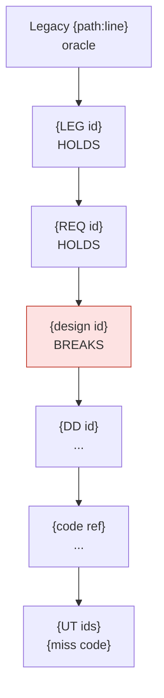

# Bug Traceability — one bug, the whole chain

> Prerequisite: `mig_project` resolved. Read-only on everything except the dossier and its
> register row under `{{profile.paths.bug_traces}}`.

`mig_uat_bug` answers *what is the direct cause, and how is it fixed*. This skill answers
the three questions that come after it — the ones the client asks at the next review:

1. **Where did the defect enter?** The first link of the chain that is wrong — not the file
   the fix will touch.
2. **Which change put it there, and what has happened to it since?** The introducing commit,
   every commit on that code since, the merge and the release that shipped it.
3. **Why was it found here and not earlier?** The check that was supposed to catch it, and —
   with evidence — why it did not.

The first answer fixes a bug. The other two fix the process that produced it, which is the
only thing that stops the next bug of the same shape from reaching UAT.

| Situation | Use |
|---|---|
| A UAT bug needs a cause and a fix | `mig_uat_bug` first; this skill for the dossier |
| A failed run needs classifying | `mig_defect_triage` first; this skill per `PRODUCT-DEFECT` worth tracing |
| Any bug whose origin, history or late detection must be proven | this skill |
| "Why did testing not catch this?" | this skill |

---

## Standing constraints

**C1 — read-only.** No edit to product code, documents, test cases or legacy. The dossier
and its register row are the only writes. A fix goes through `/mig_uat_fix` (or the phase's
normal route) behind its own approval.

**C2 — every link is anchored or declared unverified.** Each chain row cites a `path:line`,
a document id and section, a commit hash, or a test id and round. A row without evidence is
`UNVERIFIED`, with what would verify it — never inferred from the rows around it (NI-01).

**C3 — the oracle is the legacy.** Expected behaviour comes from the legacy source and its
data objects — not from the design, not from the code (`rules/common/testing.md`). Where the
legacy is silent the trace stops there as `SPEC-GAP` (NI-05). Where a CR is the ancestor,
the CR text is the oracle for exactly what it says and nothing more (`mig_change_request`
C2).

**C4 — injection is decided by the chain, not by where the fix lands.** Walk top-down; the
injection point is the first broken link. "Found in UAT, fixed in code, therefore a coding
defect" is the error this skill exists to prevent.

**C5 — history is read, never moved.** Allowed: `log`, `blame`, `show`, `diff`, `rev-list`,
`rev-parse`, `merge-base`, `describe`, `name-rev`, `branch --contains`, `tag --contains`,
`cat-file`. Never, in the user's working tree: `checkout`, `switch`, `reset`, `restore`,
`stash`, `rebase`, `commit`, `push`, `fetch`, `bisect`. A bisect runs only on explicit
approval, inside a separate `git worktree` that is removed afterwards. Moving history
destroys the evidence being read, and the user's uncommitted work with it.

**C6 — name the commit, not the culprit.** Author and date are recorded because they are
evidence and because the author is who you ask. Conclusions attribute the defect to a phase
and a check, never to a person — no per-author counts, no ranking. A trace that reads as
blame gets suppressed the second time; a process trace gets acted on.

**C7 — the bug id comes from the user.** Never invented, never derived from a module id or a
file count (`mig_uat_bug` C4). The trace can run without it; the dossier cannot be filed
without it — ask.

**C8 — report what was established, and only that.** A shallow clone, squashed history,
documents kept outside version control, results never recorded: the section says so and
names what would close the gap. A plausible reconstruction presented as history is worse
than a stated gap.

**C9 — language and location.** The dossier goes under `{{profile.paths.bug_traces}}` in
the language `{{profile.language.by_path}}` binds to that path. IDs, hashes, paths and code
are never translated.

The `{{profile.bug_trace.*}}` keys are optional. An absent or empty key means *detect*, not
*stop*.

---

## 1. Establish the starting point

**Restate the bug**: id, module, symptom (action, input, observed, expected), and the
detection record — phase, level, test id or reporter, environment, **build or commit**,
date. Without the detection build, "was the defect in what was tested?" cannot be answered;
ask for it before §4.

**Read what already exists** before re-deriving it: the report for this id under
`{{profile.paths.uat_reports}}`, the triage report that raised it, CR reports touching the
module under `{{profile.paths.change_requests}}`, the module's rows in
`{{profile.paths.traceability}}`. An existing conclusion is verified, not repeated — and
where the evidence disagrees with it, the disagreement goes into the dossier.

**Fix the trace reference.** Every later statement is relative to it:

```bash
git -C <path> rev-parse --show-toplevel   # per path — design, code and tests may be separate repos (LR-06)
git rev-parse HEAD && git branch --show-current
git rev-parse --is-shallow-repository
```

A shallow clone cannot show introduction. Say so (C8) rather than report the oldest commit
it happens to hold as the origin.

---

## 2. Walk the chain — find the first broken link

| Layer | Artifact | Where | Phase |
|---|---|---|---|
| Oracle | legacy behaviour | `{{profile.legacy.ui_source}}`, `{{profile.legacy.logic_source}}`, `{{profile.legacy.db_source}}` | — |
| LEG | `LEG-*` catalogue entry | legacy inventory | P0 |
| REQ | `REQ-*` | `{{profile.paths.requirements}}` | P1 |
| BD | SC / FC / API / data / batch | `{{profile.paths.design_root}}` | P2 |
| DD | detail design | `{{profile.paths.detail_design}}` | P3 |
| CODE | source symbol | `{{profile.target.root}}` | P4 |
| TEST | UT / IT / UAT cases | `{{profile.paths.test_design}}`, `{{profile.testing.paths.testcase_root}}` | P5–P7 |

Resolve the ids from the register, then confirm each against the file on disk — the
register alone is not evidence (`/mig_trace_check` step 2). Use the locator map in
`mig_uat_bug`; a repository-wide search as the first move finds the symptom, not the cause.

For each layer record: the artifact, its anchor, its version (revision row or commit), a
short quote of what it says or does about the disputed behaviour, and a verdict **against
the layer above**:

| Verdict | Meaning |
|---|---|
| `HOLDS` | states the oracle's behaviour correctly |
| `BREAKS` | contradicts the layer above |
| `SILENT` | exists, says nothing about this behaviour |
| `ABSENT` | the artifact does not exist — no `LEG-*` entry, no DD, no case |
| `UNVERIFIED` | exists, cannot be checked — say why |

### The injection rule

**The injection point is the first `BREAKS` from the top.** The edge cases below are most of
the real ones:

| Situation | Injection |
|---|---|
| The legacy is silent on the behaviour | none — `SPEC-GAP`; the trace records the gap and stops |
| The legacy does it; no `LEG-*` records it | **P0** — never catalogued, so nothing downstream could carry it |
| A layer is `SILENT` where its own rules require it to speak (a legacy rounding rule under FD-L, a field length under SD-F), and the code below is wrong | **that layer** — an omission is a break when the layer's rules demand the content; cite the rule |
| A layer is `SILENT` where nothing requires it, and the code is wrong | the code's phase |
| A layer `BREAKS`, but the code below it happens to match the legacy | that layer — a latent `DESIGN-DEFECT`, still recorded |
| The code matched its design when written; a later change broke it | the **later change** — its phase and vehicle (§3.5) |
| Every layer `HOLDS` and the legacy itself does the same thing | `LEGACY` — reproduced faithfully, not a migration defect; `NOT-A-BUG` or `ENHANCEMENT` |
| The product layers `HOLD`; a test case `BREAKS` | no product injection — a test defect (`SCRIPT-ERROR` or a case defect) |
| Data or environment | none — `DATA-ISSUE`; record where the environment differs |

Classification stays `mig_uat_bug`'s. The trace adds the injection the class implies:

| Class | Injection |
|---|---|
| `CODE-DEFECT` | P4, or the phase of the later change that broke it |
| `DESIGN-DEFECT` | P2 / P3 — the code is unaffected; the defect is latent |
| `PARITY-DEFECT` | the highest broken layer — P2, or P1 / P0 above it |
| `FROZEN-OBJECT` | `LEGACY` — inside a read-only object carried over; name the object (LR-02) |
| `SPEC-GAP`, `DATA-ISSUE`, `NOT-A-BUG`, `ENHANCEMENT` | none |

---

## 3. Code archaeology — the commit trail

For every defective location: the commit that introduced it, the full history of that code,
what carried it to the mainline and into which releases, and whether the design moved before
or after the code. `git blame` is the start of this, never the answer — a reformat destroys
it (LR-01), and so does a rename, a move or a merge.

### 3.1 Locate

The `file:line` range from the CODE row of §2. For an **omission** — a missing condition,
branch or message — the location is the function where the code should be.

If the bug is already fixed, trace the parent of the fix, not `HEAD`: the defective lines no
longer exist there. Every command below takes `<fix-sha>^` in place of the working tree.

### 3.2 Candidate from blame

```bash
git blame -w -C -C -M --date=short -L <start>,<end> [<fix-sha>^] -- <file>
# add --ignore-revs-file .git-blame-ignore-revs when the repository has one
```

Blame reports the last commit to touch each line. That is a candidate, nothing more.

### 3.3 Confirm by walking the range

```bash
git log -L <start>,<end>:<file> --date=short --format='%h %ad %an %s'
git log -L :<function>:<file> ...     # when the range has moved since
git show <sha> -- <file>              # read the candidate's diff in full
```

The introducing commit is the **oldest commit in which the defective logic has its defective
form**. Its diff shows which of two things happened: the code was written wrong, or correct
code was changed into wrong code. The dossier states which.

### 3.4 Omissions and deletions — blame cannot see them

Search for the token the correct code would contain — the condition, constant, `MSG-*` id,
column name, rounding mode:

```bash
git log -S '<literal>' --date=short --format='%h %ad %an %s' -- <path>
git log -G '<regex>'   --date=short --format='%h %ad %an %s' -- <path>
```

Two possible outcomes, and the dossier names which: **removed by commit X** — injection is
X's phase — or **never present** — injection is the phase that should have specified or
written it, from §2.

### 3.5 Classify the introducing commit

From its message, the files it touched, and its references — ids matching
`{{profile.change_request.id_format}}`, the bug-id format in use, module ids per
`{{profile.ids.module_pattern}}`, and `{{profile.bug_trace.commit_ref_patterns}}`:

| The introducing commit is | Vehicle | Also check |
|---|---|---|
| the module's original implementation | P4 | — |
| a CR implementation | P4 under `CR-{id}` | the CR report exists; its design step came first (`mig_change_request` C4) |
| a fix for another bug | **regression** — the phase that fix was made in | that bug's report; whether its regression test exists and covers this path |
| a refactor, reformat, rename or move that changed behaviour | P4 | whether any test pinned the behaviour before the refactor |
| a merge conflict resolution | P4 | `git show --cc <merge>` |
| generated code or a dependency bump | P4, or external | the generator input or the lockfile diff (LR-04) |

### 3.6 From commit to mainline and release

```bash
git branch -a --contains <sha>
git tag --contains <sha> [--list '{{profile.bug_trace.release_tag_pattern}}']
git describe --contains <sha>                        # first tag that carries it
# the first mainline commit containing <sha> — the merge that brought it in (bash):
comm -12 <(git rev-list --ancestry-path <sha>..<mainline> | sort) \
         <(git rev-list --first-parent  <sha>..<mainline> | sort) \
  | xargs -r git log --no-walk --date=short --format='%h %ad %s' | tail -1
```

`<mainline>` is `{{profile.bug_trace.mainline}}`, or — when empty — the branch
`origin/HEAD` points to. Tags approximate releases; where deployment records exist, they
outrank tags for "which environments received it".

Where the hosting CLI is available, the pull request that merged it
(`gh pr list --state merged --search <sha>`) holds the code review — the evidence for the P4
containment check in §4. Read it; never comment, approve or change anything on the host.

### 3.7 Design before code

Compare the date of the governing design section's last change (§3.9) with the introducing
commit. Code that predates the design text it supposedly implements was written against
something else — a draft, a conversation, an assumption. Record it as a process finding; it
is often, but not always, the cause.

### 3.8 Life since injection

```bash
git log <sha>..HEAD -L :<function>:<file> --date=short --format='%h %ad %an %s'
```

The function form, because the line numbers of §3.2 belong to one revision and have usually
moved by `HEAD`. Every commit on that code since: attempted fixes, partial fixes, reverts, the fix for this
bug if it exists. A defect that has been "fixed" twice before is a pattern, not a slip —
report it as one.

### 3.9 Documents and test cases have history too

When design documents and test cases live in the repository, walk them the same way:

```bash
git log --follow --date=short --format='%h %ad %an %s' -- <doc>
git log -L '/<section heading>/,+<n>:<doc>' --date=short    # one section only
```

Set the result against the document's own revision-history table. The table records
approvals; git records edits. An edit with no revision row, or a revision row with no edit,
is a finding. For documents kept outside version control the revision table is the only
history — say so (C8).

---

## 4. Test archaeology — why it was found here

### 4.1 Where it should have been caught

Every defect is owned by two checks. The **containment check** of the phase that injected
it:

| Injected in | Containment check |
|---|---|
| P0 | anchor spot-read; `/mig_trace_check` sees missing descendants, never a missing `LEG-*` |
| P1 | `/mig_review_design` family C; every `REQ-*` cites a `LEG-*` |
| P2 | `/mig_review_design` — legacy cross-validation, X-01..X-07 |
| P3 | the GAP report, X-08 |
| P4 | `/mig_review_commit`; the module's own unit tests |
| a CR | `/mig_review_design` on the changed documents; the CR's own test phase |
| a UAT fix | its verification run and regression test (`mig_uat_bug` phase 2) |

And the **designated test level**. In a migration the oracle is the legacy at every level,
so a correctly written case catches a broken design as readily as broken code. The level that
owns a defect therefore depends on **where the behaviour is observable**, not on which
document broke:

| The behaviour is | Designated level |
|---|---|
| inside one module — a validation, calculation, message, default, field state, data access | UT (P5) |
| across modules — a flow, navigation, state carried between screens, an interface, a batch hand-off | IT (P6) |
| visible only in the client's real operation — business calendar, real volume, operational practice | UAT (P7) |

### 4.2 Detection verdict

| Verdict | When | What must be explained |
|---|---|---|
| `CONTAINED` | found by the containment check | nothing |
| `EARLY` | found before the designated level by another check | nothing |
| `ON-TIME` | found at the designated level | why the containment check missed it |
| `ESCAPED(n)` | found after the designated level; *n* = levels it passed | every check from injection to detection |
| `N/A` | no injection | why there is none |

### 4.3 Evidence, per check

- **cases that claim coverage** — the register's `test_ids` for every design id in the chain;
- **cases that should exist** — search the case documents by module, design id, `MSG-*` id,
  field label and partition value;
- **automated tests** — specs under `{{profile.testing.automation.layout.specs}}` and the
  unit tests beside the code, by function, endpoint and message id;
- **execution** — the round columns (`{{profile.testing.rounds.columns}}`), runs under
  `{{profile.testing.paths.results_root}}`, triage reports;
- **whether the tested build contained the defect**:
  ```bash
  git merge-base --is-ancestor <introducing-sha> <build-sha> && echo present || echo absent
  ```
- **the case file's own history** (§3.9) — when it was written, against which revision of its
  basis;
- **for containment misses** — the review report for that document revision under
  `{{profile.paths.reviews}}`, the GAP report, the commit review.

### 4.4 Miss reasons

One record per check between injection and detection. Apply the codes **in this order**; the
first that holds is the primary reason, any others that also hold are listed as secondary.

| # | Code | The check… | Proven by | Fix belongs in |
|---|---|---|---|---|
| 0 | `NOT-PRESENT` | examined a build or document revision that did not yet contain the defect — **not a miss**; re-attribute to the check of the change that introduced it | `is-ancestor` absent; run date before merge date | that change's regression scope |
| 1 | `NO-CHECK` | never happened — review skipped, GAP report not produced, level not run for the module, gate passed without it | the absent report or run | the gate assertion |
| 2 | `NO-CASE` | had no case for the behaviour — name the missing viewpoint (VP-xx), partition, boundary or flow | no case references the id or partition | the case; the test skill if the same gap repeats |
| 3 | `STALE-BASIS` | had a case written against a revision of its basis that later changed, never re-checked | case history vs basis revision or CR date | the CR cascade `test_cases` step |
| 4 | `WRONG-ORACLE` | had a case asserting the wrong value — copied from the design, from the code's output, or unanchored | expected value vs the legacy anchor | the expected-from-legacy rule; a hook once it repeats |
| 5 | `NOT-RUN` | had a right case that was not executed — skipped, blocked, outside the round, quarantined | empty or blocked result; quarantine list | the gate: not run is not passed |
| 6 | `DATA` | ran it, but the data never reached the defective partition | case data vs the failing partition | test-data design; VP-03 boundaries |
| 7 | `ENV` | ran on an environment that could not show it — stubbed interface, other configuration, toy volume. Mark `accepted` if known, `gap` if not | the environment difference | environment parity, or a risk with an owner |
| 8 | `MISTRIAGED` | ran it, it failed, and the failure was classified away — script error, infra, flaky, not reproducible, duplicate | the triage report or defect record | `mig_defect_triage` decision order; screenshot evidence |
| 9 | `REVIEW-MISS` | (document checks) reviewed and did not flag it — no checklist row, the legacy not read, or a finding closed without a change | the review report for that revision | the review family — a checklist row |

`NOT-PRESENT` is checked first because every other code assumes the defect was there to be
found. A test run blamed for missing a defect that did not yet exist moves the lesson to the
wrong place.

### 4.5 The escape statement

One per detection verdict other than `CONTAINED`, `EARLY` and `N/A`, in this form:

> Injected in **{phase}** by **{artifact / commit}** on {date}. It should have been caught by
> **{containment check}**, and at the latest at **{designated level}**. It was not, because
> **{primary code}**: {evidence}. It then passed {levels} — {code per level}. It was found at
> **{detection}**. The check that would have caught it: {a concrete case, checklist row or
> gate assertion}.

### 4.6 Prevention

- **Regression case** — at the **designated** level, not the level that found it; asserting
  the legacy behaviour with its anchor. Proposed only: the id is issued when the case is
  written (TR-ID01).
- **Process** — each miss routed to its fix per the table in §4.4, through
  `/mig_refine_skill`. One module's missing case is an artifact defect; the same viewpoint
  missing in two modules is a skill defect.
- **Siblings** — modules sharing the defective pattern: the same code idiom, the same design
  rule. List each as `verified` (read) or `suspected` (pattern match only). Parity defects are
  usually systematic.

---

## 5. The dossier

File: `{{profile.paths.bug_traces}}/{BUG-ID}_{MODULE}_trace.md`. An existing dossier for the
same id gets a new dated round appended, never overwritten — the history of what was
believed, and when, is part of the trace.

````markdown
# {BUG-ID} — Bug traceability — {short title}

> Trace taken at {repo}@{short-sha} ({branch}), {date}. Shallow: {yes|no}.
> Not under version control: {sources, or "none"}. UAT report: {path, or "none"}.

## 0. Verdict
| Item | Value |
|---|---|
| Classification | {mig_uat_bug class} |
| Injected | {phase} · {vehicle} · {artifact id} · {commit} · {date} |
| Containment check | {check} — {missed: code / n/a} |
| Designated level | {UT / IT / UAT} |
| Detected | {phase · level · test id or reporter · build · date} |
| Detection verdict | {CONTAINED / EARLY / ON-TIME / ESCAPED(n) / N/A} |
| Primary miss | {code} at {check or level} |
| Direct cause | {one sentence} |

## 1. Traceability chain

| Layer | Artifact | Anchor | Version / commit | States or does | Verdict |
|---|---|---|---|---|---|

## 2. Requirement layer
The legacy behaviour (quoted, anchored), the `LEG-*` entry, the `REQ-*` text, any CR — each
with its verdict and the reasoning behind it.

## 3. Design layer
Per document: id, section, revision, the quoted text, verdict. The relevant revision-history
rows and the section's commit history (§3.9). Cross-document checks that bear on it (X-nn).

## 4. Code layer
### 4.1 Defective location(s)
### 4.2 Introducing commit
hash · author · authored / committed · message · references · vehicle (§3.5) ·
mainline merge · first tag · pull request and its review
### 4.3 History of the code since injection
| Date | Commit | Change | Effect on the defect |
|---|---|---|---|
### 4.4 Design before code

## 5. Test layer
### 5.1 Coverage per check
| Check / level | Designated | Cases | Basis revision | Ran (round · date · build) | Defect in build | Result | Miss |
|---|---|---|---|---|---|---|---|
### 5.2 Escape statement
### 5.3 Containment miss

## 6. Timeline
| Date | Event | Reference |
|---|---|---|
Document revisions, commits, merges, tags, test runs and the detection, in one chronological
list. It is usually the timeline that shows a run happening before the defect existed.

## 7. Prevention
Regression case (level, assertion, anchor) · process fix per miss, routed to
/mig_refine_skill · siblings, verified or suspected.

## 8. Not established
What could not be verified, and what would verify it. "None." only when that is true.

## 9. Open items
| # | Item | Owner | Due |
|---|---|---|---|
````

**Register.** Append one row to `{{profile.paths.bug_traces}}/bug-trace-register.csv`
(create it with this header when absent). A re-trace appends a new row; the latest
`traced_at` per `bug_id` is current. Never rewrite earlier rows (TR-06).

```csv
bug_id,module,classification,injection_phase,injection_vehicle,injection_ref,introducing_commit,designated_level,detected_at,detection_verdict,primary_miss,regression_case,report,traced_at
```

The register is what turns single traces into a pattern: which phase leaks, which miss code
recurs, which test viewpoint keeps being absent. Feed that to `/mig_refine_skill`.

### Terminology in the deliverable languages

When `{{profile.language.dictionary}}` is set it outranks this table.

| English | 日本語 | Tiếng Việt |
|---|---|---|
| injection phase | 混入工程 | công đoạn phát sinh lỗi |
| injection cause | 混入原因 | nguyên nhân phát sinh |
| detection phase | 検出工程 | công đoạn phát hiện |
| designated level | 本来検出すべき工程 | công đoạn lẽ ra phải phát hiện |
| escape / escape cause | 流出 / 流出原因 | lọt lỗi / nguyên nhân lọt lỗi |
| introducing commit | 混入コミット | commit gây lỗi |
| containment check | 工程内検出 | kiểm tra trong công đoạn |

---

## 6. Self-check before writing

- [ ] every chain row has an anchor, or is `UNVERIFIED` with what would verify it
- [ ] injection is the first `BREAKS` from the top — not the layer the fix will touch
- [ ] the introducing commit was confirmed by `-L` / `-S` / `-G`, not taken from blame alone
- [ ] omissions were searched with `-S` / `-G`; "never present" is stated as such
- [ ] `NOT-PRESENT` was checked before any other miss code, for every check
- [ ] every miss record carries evidence, not a plausible story
- [ ] no git command that moves `HEAD`, the working tree or a ref was run
- [ ] no conclusion has a person as its subject
- [ ] §8 "Not established" is present
- [ ] the bug id came from the user

## 7. Report to the user

```
Bug trace — {BUG-ID} · {module}
  Classification : {class}
  Injected       : {phase} · {vehicle} · {artifact} · {commit} ({date})
  Designated     : {containment check} → {level}
  Detected       : {level} · {test id / reporter} · {build} ({date})
  Verdict        : {verdict} — {level}: {code} · {level}: {code}
  Regression case: {level} — {what it asserts}
  Process        : {miss → where the fix belongs}
  Not established: {n} items
  Dossier        : {path}
```
