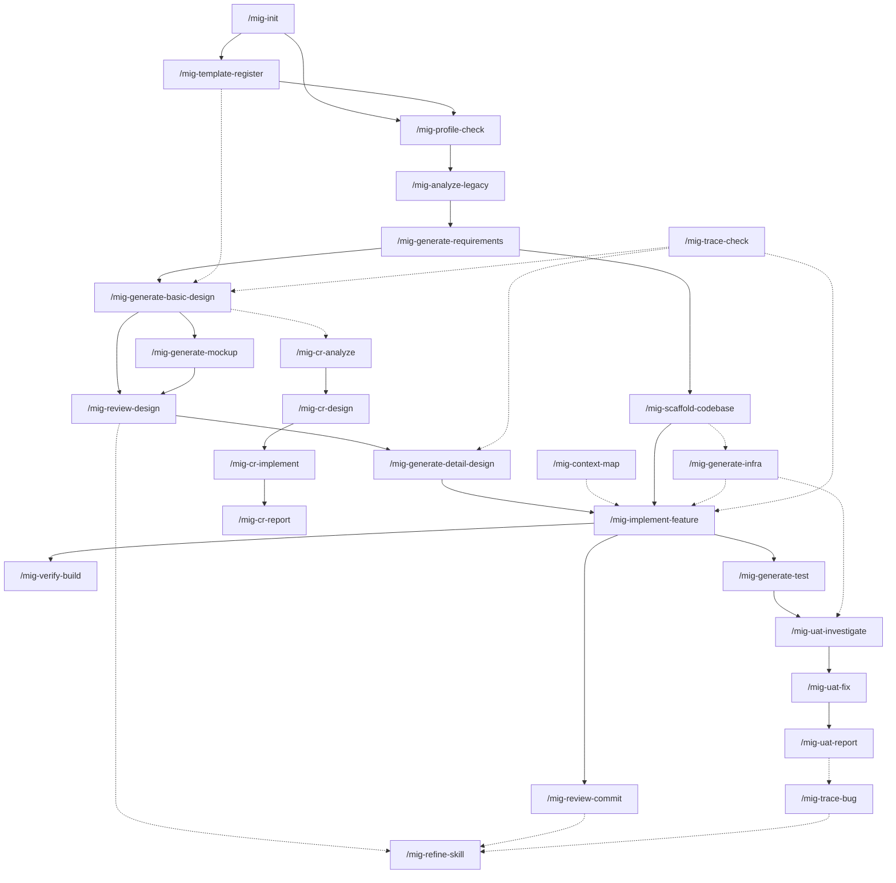

# Command Flow

How the 31 commands relate: what each one consumes and produces, what must run before
what, and the refinement loop that the whole pack is built to support.

---

## 1. Command catalogue

### Setup — run once

| Command | Reads | Writes | Agent |
|---|---|---|---|
| `/mig-init` | the repository | `migration.profile.yaml`, `CLAUDE.md`, directory scaffold, traceability header | — |
| `/mig-profile-check` | profile | nothing (report only) | — |
| `/mig-template-register` | the client's own forms | `templates.registry`, the field map, the template-gap report | — |

### Execute — produce artifacts

| Command | Reads | Writes | Agent |
|---|---|---|---|
| `/mig-analyze-legacy` | legacy source | `legacy-inventory.md`, `requirement.md`, `LEG-*` rows | `mig-legacy-analyst` |
| `/mig-generate-requirements` | P0 output, legacy source | BRD, TSD, FRD, `REQ-*` rows | `mig-requirements-writer` |
| `/mig-generate-basic-design` | FRD, legacy source | design deliverables per category | `mig-bd-orchestrator` → `mig-bd-designer` |
| `/mig-generate-mockup` | screen design, legacy UI source and captures | prototypes / artboards / Figma check, X-09 and X-10 results | `mig-mockup-designer` |
| `/mig-generate-detail-design` | design docs, target code, legacy | DD documents, GAP reports | `mig-dd-designer` |
| `/mig-scaffold-codebase` | TSD §1 §2 §4 §5 §6 §9, the profile's target stack | the target codebase skeleton, the skeleton record, real `target.build` commands | — |
| `/mig-implement-feature` | design docs, legacy source | target code | `mig-implementer` |
| `/mig-generate-infra` | the profile's platform fields, the repository | pipeline, IaC, environment matrix, coexistence and cutover plans — or proposals when another team owns them | `mig-infra-engineer` |
| `/mig-generate-test` | FC, SC, API docs, legacy | UT / IT documents | `mig-tester` |
| `/mig-generate-testscript` | reviewed manual cases, the automation repo | automated scripts | `mig-test-automator` |
| `/mig-uat-fix` | approved investigation | code, documents, regression test | `mig-uat-engineer` |
| `/mig-cr-design` | an approved CR option | design deliverables, traceability rows | `mig-cr-engineer` |
| `/mig-cr-implement` | the updated design documents | code, test cases | `mig-cr-engineer` |
| `/mig-translate` | a deliverable | its counterpart in the other language | — |

### Verify — read-only, produce findings

| Command | Reads | Writes | Agent |
|---|---|---|---|
| `/mig-review-design` | deliverables, legacy source | review reports | `mig-reviewer` |
| `/mig-review-commit` | the diff | commit review report | `mig-reviewer` |
| `/mig-verify-build` | the repository | build report | — |
| `/mig-trace-check` | register + artifacts on disk | orphan and gate report | — |
| `/mig-uat-investigate` | code, docs, legacy | conclusion, no edits | `mig-uat-engineer` |
| `/mig-review-testcase` | test cases, design, legacy, mockups | edited file / review report | `mig-reviewer` |
| `/mig-triage-failures` | a test run's results and evidence | triage report | `mig-defect-triager` |
| `/mig-trace-bug` | one bug: legacy, register, docs, code, git history, cases, results | traceability dossier + register row, no other edits | — |
| `/mig-cr-analyze` | a change request, code, docs, legacy | impact matrix and options, no edits | `mig-cr-engineer` |

### Support

| Command | Purpose |
|---|---|
| `/mig-context-map` | plan a change across layers before implementing it |
| `/mig-refine-skill` | feed review findings back into the skills and rules |
| `/mig-uat-report` | write the bug report after a fix |
| `/mig-cr-report` | write the change-request report after implementation |
| `/mig-test-lifecycle` | version history, result carry-over, condensing, evidence, between rounds |

---

## 2. Dependency graph

An arrow means "must have run, and its gate must have passed".



Solid = phase sequence. Dotted = called at any point.

**`/mig-trace-check` is the gate check for every phase**, not a phase of its own. Run it
before declaring anything complete.

The `/mig-cr-*` chain hangs off the graph rather than sitting in it: a change request can
arrive at any point from P2 onward and re-opens the phases it touches. Its two arrows that
are not negotiable are internal — analyse before design, design before code (C4).

**`/mig-template-register` is dotted into P2, and it is the one dotted arrow to treat as
solid.** It can run at any time; it should run before the first category is generated. A
category produced into the pack's own skeleton when the client expected their form is re-work
across every file in it — and the run that did it *succeeded*. The plan's template line was
the only warning.

**`/mig-generate-mockup` sits inside P2**, not after it. The mockup is reviewed alongside the
screen design, and X-09 and X-10 are P2 gate items. Run later, it means the client approved a
screen design nobody had seen drawn — and under `fidelity: as-is` the mockup is also the
cheapest place to catch a screen that drifted from the legacy layout.

**`/mig-scaffold-codebase` runs once, between the TSD and the first module.** It needs only
the TSD, not the basic design, so it usually runs while P2 is under way. It feeds
`/mig-generate-infra` because the pipeline needs the build commands the skeleton makes real.

**`/mig-generate-infra` is dotted into P4 and P7** for two different reasons. P4 because the
pipeline asserts that phase's machine-checkable criteria (IN-04). P7 because UAT and the
parallel run need somewhere production-like to execute; discovering at P7 that no such
environment exists is discovering it far too late, which is why the environment
reconciliation (X-11) and the coexistence design belong at P2.

`/mig-trace-bug` hangs off the graph the same way: it can run on any bug, from any phase,
and is drawn after `/mig-uat-report` only because that is where it is run most. Its escape
statement — which check should have caught the bug, and why it did not — is an input to
`/mig-refine-skill` exactly like a review finding: the same signal, arriving later and at a
higher price.

---

## 3. The refinement loop

The working pattern the pack is designed around. Applies to any execute command, but pays
back most on the generation phases where one skill produces dozens of artifacts.

```
   ┌──────────────────────────────────────────────────────────┐
   │                                                          │
   ▼                                                          │
1. EXECUTE          /mig-generate-*        session A          │
   │                                                          │
   ▼                                                          │
2. REVIEW           /mig-review-design     session B  ← fresh │
   │                 different agent, no shared context       │
   ▼                                                          │
3. REFINE           /mig-refine-skill      session C          │
   │                 findings → the skill, not just the file  │
   ▼                                                          │
4. RE-EXECUTE       /mig-generate-*        session D  ← fresh │
   │                                                          │
   └──────────────────────────────────────────────────────────┘
        stop when: 0 Critical AND 0 skill defects this round
```

### Why the review must be a different session

Not a formality. A generator reviewing its own output does not fail from laziness — it
fails because the reasoning that produced the error is still in its context and still
looks correct. It re-derives the same conclusion and confirms it.

A fresh session with a read-only agent has to re-derive from the sources: the legacy code,
the rules, the checklist. That is a different computation, and it is the only one that can
disagree.

Consequences worth respecting:

- do not paste the generator's explanation into the review session;
- do not tell the reviewer what the generator intended;
- `mig-reviewer` has `tools: Read, Grep, Glob` — read-only by construction, so it cannot
  quietly "fix" what it should be reporting.

### Why step 3 is the one that compounds

Fixing 46 documents by hand costs 46 units and buys nothing for document 47. Fixing the
rule that produced the defect costs one unit and buys every future document.

`/mig-refine-skill` classifies each finding before touching anything:

| Finding appears | Diagnosis | Fix |
|---|---|---|
| once | a slip | the artifact |
| in 2+ artifacts | the rule is missing or vague | the **skill** |
| reviewer and generator read the rule differently | the rule is ambiguous | the **skill** |
| rule is clear, violated anyway | restating will not help | a **hook** |
| finding contradicts a correct rule | the checklist is wrong | the **review family** |
| the legacy is silent on it | not a format problem | escalate as SPEC-GAP |

The rule that keeps the loop honest: **never weaken a rule to make a finding disappear.**
That is the same failure as closing a GAP item by editing the document to match the code —
the finding stops appearing, the defect stays, and the pack now certifies it.

### Run the loop on a pilot, then scale

The expensive mistake is running the loop on all 46 documents at once. Three rounds over
46 documents is 138 document-generations to discover a rule that a 3-document pilot would
have exposed in round one.

```
pilot batch (2–3 modules, chosen to differ from each other)
    loop until: 0 Critical and 0 skill defects
        │
        ▼
full generation with the converged skill
    loop once more, on a sample
```

Pick pilot modules that stress different parts of the skill — a simple list screen and a
transactional screen with dialogs, not two list screens. A pilot that converges because it
was easy has calibrated nothing.

### Termination

Stop the loop when a round produces **zero Critical findings and zero skill-defect
classifications**. Zero Critical alone is not enough: if the round still reclassified
findings into the skill, the next batch will hit them.

**Bound it at three rounds.** A loop that has not converged in three rounds is not a skill
problem:

| Symptom after 3 rounds | Actual cause |
|---|---|
| Same finding keeps returning in new artifacts | the rule is unenforceable as written — move it to a hook |
| Findings change every round | the reviewer's checklist is inconsistent; fix the review family first |
| Generator and reviewer disagree about the legacy | missing evidence — go back to P0 for that area |
| Findings are about business meaning, not format | a SPEC-GAP being laundered as a rule problem — escalate to the client |

Escalate rather than run a fourth round. Loops that do not converge are answering the
wrong question.

### Blast radius

Every skill change invalidates the artifacts generated under the old rule. They were
correct against a rule that no longer exists.

`/mig-refine-skill` records this in `{{profile.paths.reviews}}/skill-changes.md`, with the
list of affected artifacts. Re-review them — or knowingly accept them, and write down that
you did. What must not happen is the third state: nobody remembers the rule changed.

---

## 4. The loop per phase

The pattern is the same; what differs is the review command and the convergence signal.

| Phase | Execute | Review | Converged when |
|---|---|---|---|
| P0 | `/mig-analyze-legacy` | `/mig-trace-check` + spot-read the anchors | no downward orphans; anchors resolve to real lines |
| P1 | `/mig-generate-requirements` | `/mig-review-design` (family C) | R-01..R-06 pass; no uncited `REQ-*` |
| P2 | `/mig-generate-basic-design` | `/mig-review-design` | 0 Critical; X-01..X-07 pass |
| P3 | `/mig-generate-detail-design` | `/mig-review-design` + the GAP report itself | 0 unresolved GAP items |
| P4 | `/mig-implement-feature` | `/mig-review-commit` + `/mig-verify-build` | build clean; 0 Critical |
| P5/P6 | `/mig-generate-test` | `/mig-review-testcase` + coverage T-01..T-07 | every FC and flow covered, every viewpoint present |
| P5/P6 | `/mig-generate-testscript` | run the suite + `/mig-triage-failures` | 0 PRODUCT-DEFECT unexplained, 0 flaky |
| P7 | `/mig-uat-fix` | `/mig-uat-investigate` re-run on the symptom | symptom gone; regression test passes |
| CR | `/mig-cr-design` → `/mig-cr-implement` | `/mig-review-design` on the changed documents | 0 Critical; every required matrix row done or deferred |

At P4 the loop has a second, cheaper inner cycle: the hooks. A rule enforced by a hook
never reaches the review, because the violation was blocked at the edit. That is the end
state for any rule that is mechanically checkable — see `rules/common/hooks.md`.

---

## 5. Session hygiene

The loop depends on sessions being genuinely separate. Practical rules:

| Do | Do not |
|---|---|
| Start the review in a new session | Continue the generation session and "now review it" |
| Give the reviewer the artifact path and the rules | Give it your explanation of what the artifact meant |
| Let the reviewer read the legacy itself | Summarise the legacy for the reviewer |
| Re-execute in a fresh session after refining | Re-execute in the session that just edited the skill |
| Keep the review report as the hand-off between sessions | Rely on conversation memory to carry findings across |

The written review report is the interface between sessions. If a finding is not in the
report, it does not survive the hand-off — which is a feature: it forces findings to be
stated precisely enough to be acted on by someone with no context.

---

## 6. Typical run of a phase, end to end

P2 on a real project, from nothing to a signed-off category:

```
/mig-profile-check                          verify the pack is configured
/mig-generate-basic-design screen KK0030PG  pilot: one simple, one complex module
        ↓  new session
/mig-review-design KK0030PG                 read-only agent, no shared context
        ↓  new session
/mig-refine-skill docs/07.reviews/...          classify: artifact / skill / hook / checklist
        ↓  new session
/mig-generate-basic-design screen KK0030PG  regenerate under the changed rule
        ↓
   repeat until 0 Critical and 0 skill defects   (bound: 3 rounds)
        ↓
/mig-generate-basic-design screen           full category, converged skill
        ↓
/mig-review-design screen                   sample, not exhaustive
/mig-trace-check P2                          gate: orphans + assertions
        ↓
   report: written/expected, gate pass, Open Items for the client
```
