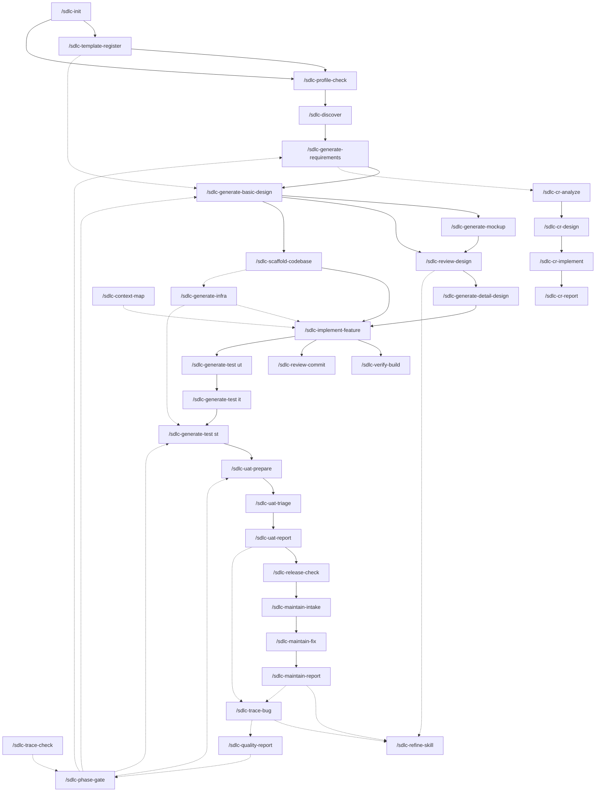

# Command Flow

How the 37 commands relate: what each one consumes and produces, what must run before what,
and the refinement loop that the whole pack is built to support.

---

## 1. Command catalogue

### Setup — run once

| Command | Reads | Writes | Agent |
|---|---|---|---|
| `/sdlc-init` | the repository | `sdlc.profile.yaml`, `CLAUDE.md`, directory scaffold, registers | — |
| `/sdlc-profile-check` | profile | nothing (report only) | — |
| `/sdlc-template-register` | the client's own forms | `templates.registry`, the field map, the template-gap report | — |

### Execute — produce artifacts

| Command | Reads | Writes | Agent |
|---|---|---|---|
| `/sdlc-discover` | the organisation, existing material | scope, `BR-*`, glossary, decision/assumption/risk logs | `sdlc-analyst` |
| `/sdlc-generate-requirements` | P0 artifacts | SRS: `REQ-*`, `NFR-*`, use cases, acceptance criteria | `sdlc-analyst` |
| `/sdlc-generate-basic-design` | SRS | design deliverables per category | `sdlc-bd-orchestrator` → `sdlc-bd-designer` |
| `/sdlc-generate-mockup` | screen design | prototypes / artboards / Figma check, X-11 results | `sdlc-mockup-designer` |
| `/sdlc-generate-detail-design` | design docs, code | DD documents, drift reports | `sdlc-dd-designer` |
| `/sdlc-scaffold-codebase` | architecture §2 §3 §5 §6 §9, the profile's stack | the codebase skeleton, the skeleton record, real `system.build` commands | — |
| `/sdlc-implement-feature` | design docs | code | `sdlc-implementer` |
| `/sdlc-generate-infra` | the profile's platform fields, the repository | pipeline definition, IaC, environment matrix, NFR monitors — or proposals when another team owns them | `sdlc-infra-engineer` |
| `/sdlc-generate-test <level>` | the level's basis document | UT / IT / ST / UAT case documents | `sdlc-tester` |
| `/sdlc-generate-testscript` | reviewed manual cases, the automation repo | automated scripts | `sdlc-test-automator` |
| `/sdlc-uat-prepare` | ST results, SRS acceptance criteria | UAT plan, readiness record | `sdlc-uat-coordinator` |
| `/sdlc-maintain-fix` | an approved investigation | code, documents, regression test | `sdlc-maintenance-engineer` |
| `/sdlc-cr-design` | an approved CR option | design deliverables, traceability rows | `sdlc-cr-engineer` |
| `/sdlc-cr-implement` | the updated design documents | code, test cases | `sdlc-cr-engineer` |
| `/sdlc-translate` | a deliverable | its counterpart in the other language | — |
| `/sdlc-test-lifecycle` | test artifacts between rounds | history, carried results, condensed tables | — |

### Verify — read-only, produce findings

| Command | Reads | Writes | Agent |
|---|---|---|---|
| `/sdlc-review-design` | deliverables, the SRS | review reports | `sdlc-reviewer` |
| `/sdlc-review-commit` | the diff, the design | commit review report | `sdlc-reviewer` |
| `/sdlc-review-testcase` | test cases, the level's basis; in `script` mode the automated scripts and the runner's listing | edited file / review report | `sdlc-reviewer` |
| `/sdlc-verify-build` | the repository | build report | — |
| `/sdlc-trace-check` | register + artifacts on disk | orphan, coverage and gate report | — |
| `/sdlc-quality-report` | reviews, defect register, test results | metrics report | — |
| `/sdlc-triage-defects` | a test run's results and evidence | triage report; with `bug-list`, the client-facing bug list | `sdlc-defect-triager` |
| `/sdlc-trace-bug` | one defect: baselines, register, docs, code, git history, cases, results | traceability dossier + register row, no other edits | — |
| `/sdlc-uat-triage` | a client report, docs, code | classification and proposal, no edits | `sdlc-uat-coordinator` |
| `/sdlc-maintain-intake` | an incident, logs, docs, code | root cause and proposal, no edits | `sdlc-maintenance-engineer` |
| `/sdlc-cr-analyze` | a change request, docs, code | impact matrix and options, no edits | `sdlc-cr-engineer` |
| `/sdlc-release-check` | the release package, ST/UAT results | go/no-go record | — |

### Decide and record

| Command | Purpose |
|---|---|
| `/sdlc-phase-gate` | evaluate entry/exit criteria, baseline the documents, record the decision |
| `/sdlc-uat-report` | UAT status, and the acceptance record |
| `/sdlc-maintain-report` | the incident report and its knowledge-base entry |
| `/sdlc-cr-report` | the change-request report, with actual effort against the estimate |

### Support

| Command | Purpose |
|---|---|
| `/sdlc-context-map` | plan a change across layers before implementing it |
| `/sdlc-refine-skill` | feed review findings and RCA conclusions back into the skills and rules |

---

## 2. Dependency graph

An arrow means "must have run, and its gate must have passed".



Solid = phase sequence. Dotted = called at any point.

**`/sdlc-phase-gate` is where a phase actually ends.** It consumes `/sdlc-trace-check` and
`/sdlc-quality-report`, records the decision, and baselines the documents it covers. A
phase declared complete without it has no record of what was approved.

The `/sdlc-cr-*` chain hangs off the graph rather than sitting in it: a change to a
baselined artifact can arrive any time from P1 onward and re-opens the phases it touches.
Its two non-negotiable arrows are internal — analyse before design, design before code (C4).

**`/sdlc-template-register` is dotted into P2 rather than solid, and that is the one dotted
arrow worth treating as solid.** It can be run at any time; it should be run before the first
category is generated. A category produced into the pack's own skeleton when the client
expected their form is re-work across every file in it, and the run that did it succeeded —
the plan's template line was the only warning.

**`/sdlc-generate-mockup` sits inside P2**, not after it. The mockup is reviewed with the
screen design, and X-11 is a P2 gate item; running it later means the client approved a
screen design nobody had seen drawn.

**`/sdlc-scaffold-codebase` runs once, between the architecture and the first module.** It
needs only the architecture document, not the whole of P2, so it usually runs while the
other categories are still being designed. It feeds `/sdlc-generate-infra` because the
pipeline needs the build commands the skeleton makes real.

**`/sdlc-generate-infra` is dotted into P4 and P7** for two different reasons. P4 because the
pipeline asserts that phase's machine-checkable exit criteria (IN-03). P7 because system test
needs somewhere production-like to run, and discovering at P7 that nothing can deploy there
is discovering it a phase too late — which is why the environment reconciliation (X-12)
belongs at P2, with the architecture.

---

## 3. The V-model, expressed as commands

The left side produces a specification; the right side proves it. The pairing determines
which basis document each `/sdlc-generate-test` run reads:

```
/sdlc-discover              ←──────────────────────────→  /sdlc-uat-prepare
  /sdlc-generate-requirements  ←────────────────────→  /sdlc-generate-test st
    /sdlc-generate-basic-design  ←──────────────→  /sdlc-generate-test it
      /sdlc-generate-detail-design  ←────────→  /sdlc-generate-test ut
        /sdlc-implement-feature  ─────────
```

Practical consequences:

- Run `/sdlc-generate-test st` against the **SRS**, not against the screens. A system test
  derived from screens is an integration suite that runs late and expensively.
- Draft cases early, finalise them against the baselined document, and re-check them when a
  CR changes it. `/sdlc-generate-test` marks its output provisional when the basis is not
  yet baselined.
- If no case can be written at a level, the specification at that level is not finished.
  That is a gate failure on the **left** side, not a testing problem on the right.

---

## 4. The refinement loop

The working pattern the pack is designed around. Applies to any execute command, but pays
back most on the generation phases where one skill produces dozens of artifacts.

```
   ┌──────────────────────────────────────────────────────────┐
   │                                                          │
   ▼                                                          │
1. EXECUTE          /sdlc-generate-*        session A         │
   │                                                          │
   ▼                                                          │
2. REVIEW           /sdlc-review-design     session B  ← fresh│
   │                 different agent, no shared context       │
   ▼                                                          │
3. REFINE           /sdlc-refine-skill      session C         │
   │                 findings → the skill, not just the file  │
   ▼                                                          │
4. RE-EXECUTE       /sdlc-generate-*        session D  ← fresh│
   │                                                          │
   └──────────────────────────────────────────────────────────┘
        stop when: 0 Critical AND 0 skill defects this round
```

### Why the review must be a different session

Not a formality. A generator reviewing its own output does not fail from laziness — it fails
because the reasoning that produced the error is still in its context and still looks
correct. It re-derives the same conclusion and confirms it.

A fresh session with a read-only agent has to re-derive from the sources: the SRS, the
rules, the checklist. That is a different computation, and it is the only one that can
disagree.

Consequences worth respecting:

- do not paste the generator's explanation into the review session;
- do not tell the reviewer what the generator intended;
- `sdlc-reviewer` has `tools: Read, Grep, Glob` — read-only by construction, so it cannot
  quietly "fix" what it should be reporting.

### Why step 3 is the one that compounds

Fixing 46 documents by hand costs 46 units and buys nothing for document 47. Fixing the rule
that produced the defect costs one unit and buys every future document.

`/sdlc-refine-skill` classifies each finding before touching anything:

| Finding appears | Diagnosis | Fix |
|---|---|---|
| once | a slip | the artifact |
| in 2+ artifacts | the rule is missing or vague | the **skill** |
| reviewer and generator read the rule differently | the rule is ambiguous | the **skill** |
| rule is clear, violated anyway | restating will not help | a **hook** |
| finding contradicts a correct rule | the checklist is wrong | the **review family** |
| a defect escaped because no phase looked for it | the gate is missing an assertion | the **gate** |
| the specification is silent | not a format problem | escalate as an open question |

The rule that keeps the loop honest: **never weaken a rule to make a finding disappear.**
That is the same failure as closing a drift item by editing the document to match the code —
the finding stops appearing, the defect stays, and the pack now certifies it.

### The loop's second input: escaped defects

An escaped defect is the same signal as a repeated review finding, arriving later and at
higher cost. Every RCA answers "why was it not caught?" (`sdlc-maintenance`), and that
answer goes into the same classification table. `/sdlc-trace-bug` is how that answer gets
evidence instead of an opinion: an escape statement, and one miss code per check the defect
passed. A project that runs the loop only on review
findings learns from its documents; one that also runs it on escapes learns from production.

### Run the loop on a pilot, then scale

The expensive mistake is running the loop on all 46 documents at once. Three rounds over 46
documents is 138 document-generations to discover a rule that a 3-document pilot would have
exposed in round one.

```
pilot batch (2–3 modules, chosen to differ from each other)
    loop until: 0 Critical and 0 skill defects
        │
        ▼
full generation with the converged skill
    loop once more, on a sample
```

Pick pilot modules that stress different parts of the skill — a simple list screen and a
transactional screen with dialogs and a batch, not two list screens. A pilot that converges
because it was easy has calibrated nothing.

### Termination

Stop when a round produces **zero Critical findings and zero skill-defect
classifications**. Zero Critical alone is not enough: if the round still reclassified
findings into the skill, the next batch will hit them.

**Bound it at three rounds.** A loop that has not converged in three rounds is not a skill
problem:

| Symptom after 3 rounds | Actual cause |
|---|---|
| Same finding keeps returning in new artifacts | the rule is unenforceable as written — move it to a hook |
| Findings change every round | the reviewer's checklist is inconsistent; fix the review family first |
| Generator and reviewer disagree about the requirement | the requirement is ambiguous — go back to P1 for that area |
| Findings are about business meaning, not format | an open question being laundered as a rule problem — escalate to the owner |

Escalate rather than run a fourth round. Loops that do not converge are answering the wrong
question.

### Blast radius

Every skill change invalidates the artifacts generated under the old rule. They were correct
against a rule that no longer exists.

`/sdlc-refine-skill` records this in `{{profile.paths.reviews}}/skill-changes.md`, with the
list of affected artifacts. Re-review them — or knowingly accept them, and write down that
you did. What must not happen is the third state: nobody remembers the rule changed.

---

## 5. The loop per phase

The pattern is the same; what differs is the review command and the convergence signal.

| Phase | Execute | Review | Converged when |
|---|---|---|---|
| P0 | `/sdlc-discover` | client review of scope + `/sdlc-trace-check` | every `BR-*` has an owner, a priority and a source |
| P1 | `/sdlc-generate-requirements` | `/sdlc-review-design` (families C, RQ) | R-01..R-08 pass; no TBD; every REQ testable |
| P2 | `/sdlc-generate-basic-design` | `/sdlc-review-design` | 0 Critical; X-01..X-10 pass |
| P3 | `/sdlc-generate-detail-design` | `/sdlc-review-design` + the drift report | 0 unresolved drift items; DDs are testable |
| P4 | `/sdlc-implement-feature` | `/sdlc-review-commit` + `/sdlc-verify-build` | build clean; 0 Critical; no unrequested behaviour |
| P5/P6 | `/sdlc-generate-test ut\|it` | `/sdlc-review-testcase` + coverage T-01..T-04 | every rule and flow covered, every viewpoint present |
| P7 | `/sdlc-generate-test st` | execution + `/sdlc-triage-defects` | every REQ and NFR executed and measured; curve flattened |
| P8 | `/sdlc-uat-prepare` | the client's own execution | every scenario has a verdict; acceptance recorded |
| P9 | `/sdlc-maintain-fix` | `/sdlc-maintain-intake` re-run on the symptom | symptom gone; regression test passes; preventive action owned |
| CR | `/sdlc-cr-design` → `/sdlc-cr-implement` | `/sdlc-review-design` on the changed documents | 0 Critical; every required matrix row done or deferred |

At P4 the loop has a second, cheaper inner cycle: the hooks. A rule enforced by a hook never
reaches the review, because the violation was blocked at the edit. That is the end state for
any rule that is mechanically checkable — see `rules/common/hooks.md`.

---

## 6. Session hygiene

The loop depends on sessions being genuinely separate. Practical rules:

| Do | Do not |
|---|---|
| Start the review in a new session | Continue the generation session and "now review it" |
| Give the reviewer the artifact path and the rules | Give it your explanation of what the artifact meant |
| Let the reviewer read the SRS itself | Summarise the requirements for the reviewer |
| Re-execute in a fresh session after refining | Re-execute in the session that just edited the skill |
| Keep the review report as the hand-off between sessions | Rely on conversation memory to carry findings across |

The written review report is the interface between sessions. If a finding is not in the
report, it does not survive the hand-off — which is a feature: it forces findings to be
stated precisely enough to be acted on by someone with no context.

---

## 7. Typical run of a phase, end to end

P2 on a real project, from nothing to a passed gate:

```
/sdlc-profile-check                            verify the pack is configured
/sdlc-generate-basic-design architecture       decisions everything else depends on
/sdlc-generate-basic-design nfr                the measurements P7 will need
/sdlc-generate-basic-design screen SL0030PG    pilot: one simple, one complex module
        ↓  new session
/sdlc-review-design SL0030PG                   read-only agent, no shared context
        ↓  new session
/sdlc-refine-skill docs/08.reviews/...            classify: artifact / skill / hook / checklist
        ↓  new session
/sdlc-generate-basic-design screen SL0030PG    regenerate under the changed rule
        ↓
   repeat until 0 Critical and 0 skill defects      (bound: 3 rounds)
        ↓
/sdlc-generate-basic-design screen             full category, converged skill
        ↓
/sdlc-review-design screen                     sample, not exhaustive
/sdlc-trace-check P2                           orphans + coverage
/sdlc-quality-report P2                        density, and what it predicts for P3
/sdlc-phase-gate P2 exit                       decision recorded, documents baselined
```

From the gate onward those documents change only through `/sdlc-cr-*`. That is the point of
the gate, and it is worth saying out loud to the team on the day it passes.
