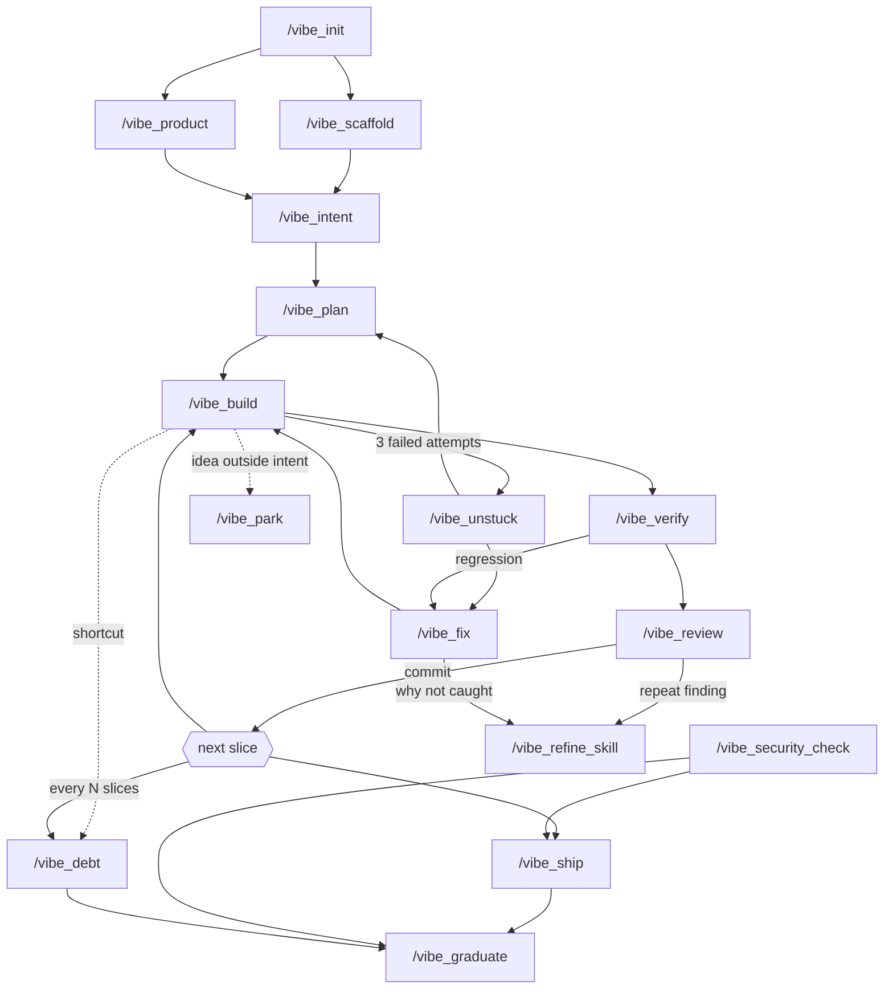

# Command Flow

How the 20 commands relate: what each reads and writes, the loop they are built around, the
flow at each stage, and the refine loop.

---

## 1. Command catalogue

### Setup — once

| Command | Reads | Writes | Agent |
|---|---|---|---|
| `/vibe_init` | the repository | profile, `vibe/` memory folder, `CLAUDE.md` | — |
| `/vibe_profile_check` | profile, repo, hooks | nothing (report) | — |
| `/vibe_scaffold` | profile, stack choice | skeleton, tooling, `DEC-001`, real commands | — |

### Decide what to build

| Command | Reads | Writes | Agent |
|---|---|---|---|
| `/vibe_product` | answers, existing app | `PRODUCT.md`, `DEC-*` on revision | — |
| `/vibe_intent` | request, PRODUCT.md | `INT-NNN-*.md` | — |
| `/vibe_plan` | intent, code | slices in the intent, STATE.md Next | `vibe_planner` |
| `/vibe_park` | an idea | `IDEA-*` in backlog | — |

### Build — the loop

| Command | Reads | Writes | Agent |
|---|---|---|---|
| `/vibe_build` | intent, slice, code | code, tests, commit, intent log, STATE.md, `DEBT-*` | `vibe_builder` (+ `vibe_verifier`, `vibe_reviewer` from mvp) |
| `/vibe_verify` | intent, running app | STATE.md Last verified, `BUG-*` for regressions | `vibe_verifier` |
| `/vibe_review` | diff, intent | review report, proposed `DEBT-*` | `vibe_reviewer` |

### When it breaks

| Command | Reads | Writes | Agent |
|---|---|---|---|
| `/vibe_fix` | symptom, code, git history | `BUG-*`, fix, regression check | `vibe_debugger` |
| `/vibe_unstuck` | the failed attempts | `attempt/*` branch, STATE.md | — |

### Keep it healthy

| Command | Reads | Writes | Agent |
|---|---|---|---|
| `/vibe_debt` | ledger, code | `DEBT-*`, paydown commits | — |
| `/vibe_security_check` | code, history, deps, config | security report, security `DEBT-*` | `vibe_security_auditor` |
| `/vibe_refine_skill` | reviews, bugs, corrections | skill/rule/hook/CLAUDE.md edits, skill-changes log | — |

### Ship and grow

| Command | Reads | Writes | Agent |
|---|---|---|---|
| `/vibe_ship` | git log, checks, profile.release | release note; deploy handed to the human | — |
| `/vibe_graduate` | everything | `DEC-*`, profile `stage`, `HANDOFF.md` | — |

### Sessions

| Command | Reads | Writes |
|---|---|---|
| `/vibe_resume` | STATE.md, git | nothing, or re-verification |
| `/vibe_handoff` | the session | logs, CLAUDE.md conventions, STATE.md |
| `/vibe_status` | all records, git | nothing |

---

## 2. Dependency graph



Every session is wrapped in `/vibe_resume` … `/vibe_handoff`.

---

## 3. A session, end to end

```
/vibe_resume                          ← hook already printed STATE.md; compare with git
  "Now: INT-007.2 — ownership on page + API; API done, page not"
/vibe_build INT-007.2                 ← restate, clean tree, map (3 files), build
  … hook: slice budget fine
  … verifier: check 3 ❌ user B sees edit button → fix → ✅
  … reviewer: 0 Critical, 1 Medium (bare TODO → DEBT-016)
  commit "INT-007.2: enforce note ownership on page and API"
/vibe_build INT-007.3
  … attempt 1 ❌, 2 ❌, 3 ❌ (zod error message not shown)
/vibe_unstuck                         ← attempts on attempt/INT-007.3-1, back to checkpoint
/vibe_fix "validation message not shown"
  … cause: server action returns error object but form reads `state.message` (v19 API)
  … regression test red → green; commit "BUG-012: form reads useActionState error shape"
/vibe_build INT-007.3                 ← now 1 attempt, done
/vibe_park "markdown preview"         ← the owner's idea mid-slice → IDEA-024, not built
/vibe_handoff                         ← DEC ×1, DEBT ×1, IDEA ×1 logged; STATE.md rewritten
```

---

## 4. Flows by stage

### spike — "can this even work?"

```
git switch -c spike/<question>
/vibe_intent (one line + assumptions)  →  build freely  →  answer the question
→ DEC-* with the answer  →  delete or abandon the branch
```
Still in force: secrets, destructive-command guard, synthetic data, the answer written down.

### prototype — "show it to someone"

```
/vibe_init → /vibe_scaffold → /vibe_product
loop per feature:  /vibe_intent → /vibe_plan → /vibe_build (→ /vibe_verify) → commit
every session:     /vibe_resume … /vibe_handoff
before showing it: /vibe_verify all
```

### mvp — "real users"

```
/vibe_graduate mvp   ← refused until: core flows automated, CI, security check, due debt paid
loop per feature:  /vibe_intent → /vibe_plan → /vibe_build
                   (verifier and reviewer are separate agents; review every slice)
every 4–5 slices:  /vibe_debt pay
before release:    /vibe_security_check → /vibe_ship
```

### production — "people depend on it"

```
/vibe_graduate production
per release:  /vibe_verify all → /vibe_security_check → /vibe_ship (E2E smoke, rollback rehearsed)
incidents:    /vibe_ship rollback first → /vibe_fix → "why not caught" → /vibe_refine_skill
decide:       /vibe_graduate handoff  (sdlc / pm / both / stay)
```

---

## 5. Adopting on an existing vibe-coded repo

The common case: something already exists, built without any of this.

```
/vibe_init            ← inspect; honest stage; secrets findings first
/vibe_scaffold        ← retrofit lint/typecheck/test; record what they report as DEBT-*, fix nothing yet
/vibe_product         ← from what the app does + what the owner says it should
(one /vibe_intent per existing feature, status done, checks it SHOULD meet)
/vibe_verify all      ← failures become BUG-*
/vibe_debt sweep      ← expect many; that is the point
/vibe_security_check  ← if it has a URL or users, before anything else
```
Then back to the normal loop, with debt paydown weighted toward security and core flows.

---

## 6. The refine loop

```
  execute (/vibe_build) → verify / review → finding
        ▲                                   │ seen before?
        │                                   ├─ no  → fix the code
        │                                   └─ yes → /vibe_refine_skill
        │                                             │ classify: skill · rule · hook · check ·
        │                                             │           CLAUDE.md convention · checklist
        └────────── re-run the affected slices ◄─────┘ record blast radius in skill-changes.md
```

The loop is closed when the generator has run again under the changed rule and the review
comes back clean. **A rule is never weakened to make a finding disappear.**

In vibe coding the signal arrives fast: the same correction given to the AI twice in one week
is already a pattern. Put it in `CLAUDE.md` (SC-06) the second time, not the tenth.
